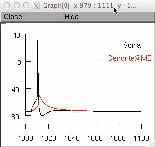
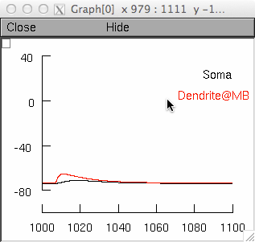
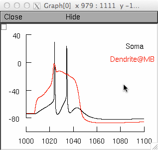
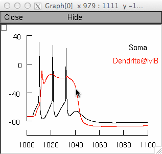

# Readme for the Model Associated with the Paper

Schaefer AT, Larkum ME, Sakmann B, Roth A (2003) Coincidence detection in pyramidal neurons is tuned by their dendritic branching pattern.
*J Neurophysiol* 89:3143-54

These model files were supplied by Dr A.T. Schaefer.

> **NOTE:** Tested by now (4/03) only in a Unix environment, known difficulties in space plot presentation with some Windows versions.

## Proceed as follows:

- Compile mod files:

  ```bash
  cd mod; nrnivmodl; cd ..
  ```

  Warning messages might appear; a file "special" is created.

- Run the demo:

  ```bash
  mod/special BACModel.hoc -
  ```

- Stimuli are applied by executing the according panel buttons which replicate Fig 2A in the paper.

## Clicking on Backpropagating AP will display



## Clicking on EPSP:



## Clicking on Ca spike:



## Clicking on BAC firing:



## Note:

- The internal calcium concentration as shown by the bottom left space plot is calculated in the absence of any buffering; thus values are given in arbitrary units.
- Best visual presentation is achieved with a black background (which implies changing NEURON parameter files accordingly).
- The axon might not be visible due to the small size.
- Stimuli are set to be at "threshold"; slightly (100-200 pA) smaller current injection will also yield "regenerative events" that are however delayed in the case of the Na spike and "creeping and late" in the case of the Ca spike / BAC-firing.
- The model was constructed to equally well reproduce BAC firing in a whole class of Layer 5 pyramidal neurons and allow comparison; it was not designed to incorporate all measurements of channel properties (thus e.g. the lack of Ih).

Best Wishes,
Andreas Schaefer
andreas.schaefer at crick.ac.uk

---

Changelog
---
2023-02-28: updated for C++ compatibility (NEURON 9+)

2023-04-20: updated for SoA data compatibility (NEURON 9+)

2025-05-27 – Standardized to Markdown.
